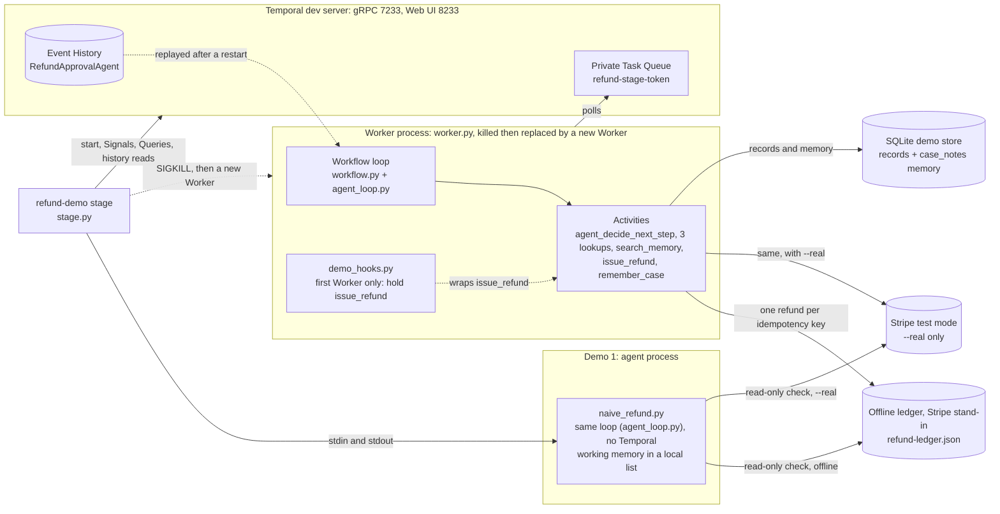

# Agent Memory and State

<div align="center">

[](https://github.com/temporal-community/temporal-ai-agent-memory-state-stripe/actions/workflows/ci.yml)
[](LICENSE)
[](pyproject.toml)
[](https://github.com/temporalio/sdk-python)
[](https://docs.stripe.com/test-mode)
[](https://docs.astral.sh/uv/)

</div>

> [!NOTE]
> This is a teaching demo. It simulates a customer-support agent handling a
> refund, with sample data in a small SQLite store, a customer whose answers
> the guided run fills in, and Stripe test mode or an offline ledger. It shows the pattern
> for keeping an agent's work durable, not a complete production setup.

As agents run longer and take on more complex work, how they handle memory and
state starts to matter. An agent that loses its place partway through a task
can leave a customer repeating themselves, or leave a job half done. Managing
that well starts with knowing what an agent keeps, where each piece lives, and
what survives a crash.

**The main takeaway:** building an agent on Temporal gives you working memory
that survives a crash. You don't have to write code to save or restore it.

This repo steps you through that with a working demo and the resources behind
it. These are the kinds of information the demo explains:

- **Memory:** what the agent knows.
  - **Context:** what the model sees this turn: the request, the conversation
    so far, and the results of its last steps. The model reasons only on
    what's in context, so what goes in, and what's left out, shapes every
    choice it makes.
  - **Working memory:** this run's conversation and tool results. On Temporal,
    it is part of the Workflow's state.
  - **Long-term memory:** what carries across runs, kept in a store you own.
    This demo keeps case notes in a SQLite table of their own, apart from the
    customer records. Managed options such as mem0 and Amazon Bedrock
    AgentCore Memory fill the same role. The agent pulls from it into context
    when it needs it, here with its `search_memory` tool.
- **State:** where the work stands and what it has already done.
  - **Execution state (Workflow state):** where the run is, plus its working
    memory. Temporal records it in Event History and rebuilds it by replay, so
    a new Worker can pick the work back up.
  - **The refund itself:** Stripe is the source of truth for whether the
    refund happened. The `issue_refund` Activity result is the Workflow's
    record of it, and the idempotency key reconciles the two after a crash.

When you know where each kind of information lives, you can build agents that
run longer and take on more complex work. The demo stops the same agent
mid-task twice, once without Temporal and once with it, so you can see which
kinds survive a crash. A memory store can bring back what an agent learned in
earlier runs, but it can't tell a new process where this run stood or whether
the refund went through. The Workflow's state answers the first, and Stripe
answers the second.

**What happens to an AI agent's in-flight work when its process dies?** The
demo kills a customer-support refund agent one step before it refunds the
customer. By then the agent has asked the customer what it needed (the offline
fixed policy asks two questions), looked up the order and the customer's refund
history, checked its long-term memory for past cases, and chosen
`issue refund`.

- **Demo 1, without Temporal:** that progress dies with the agent process, and
  the customer has to start the return again. The failure mode is **lost loop
  position**.
- **Demo 2, with Temporal:** the same loop runs as a Temporal Workflow. A new
  Worker rebuilds it from Event History and resumes at `issue refund` without
  repeating a question.

The agent is a hand-written Python loop with no agent framework, so Temporal's
role is easy to see: it records the execution state outside the agent's
process. A new process can then pick up the work.

<!-- Inline <a id> tags keep older section links (#videos, #resources, and so on) landing in the right place. -->

<a id="see-the-idea-in-15-seconds"></a>[![The demo in eight frames. Demo 1, without Temporal: the agent process collects two answers, looks up the order and refund history, searches past cases in memory (none yet), and chooses issue refund, then shows PROCESS GONE. The new agent process has no answers and no next step, checks the offline ledger (paid, no refund), and tells the customer to start the return again. Demo 2, with Temporal: after WORKER GONE, the What Survives pane reads from Temporal 2 customer answers, 3 completed lookups, and next action issue refund. The new Temporal Worker shows NO REPEATED QUESTIONS and NO LOOP RESTART, says "Your refund is complete" without the customer asking, shows the case note it saved to long-term memory, and the ledger shows the refund SUCCEEDED.](assets/demo-reel.gif)](assets/demo-reel.mp4)

- **Slides from the video:** [*Agentic Memory and State*, October 2026 (PDF)](docs/temporal-ai-agentic-memory-and-state-deck.pdf)
- **Slides from the TAI meetup:** [*Agentic Memory and State*, in English and Japanese (PDF)](docs/agentic-memory-and-state-tai-meetup.pdf)
- **Video:** [Watch the 13-minute walkthrough on YouTube](https://www.youtube.com/watch?v=cXKQkrgn-TE)

**Last verified:** 2026-11-23 (offline tests and an offline stage run on the
current code, and one live pass on GPT-5.6 Luna that predates the
`search_memory` tool). Failure path: 2026-10-06.

## Run it

<a id="run-the-guided-demo"></a>**You need:**

- Python 3.11+
- [uv](https://docs.astral.sh/uv/), tested on 0.11.8
- the [Temporal CLI](https://docs.temporal.io/cli?utm_source=github&utm_medium=readme&utm_campaign=temporalaimemory), tested on 1.6.2

**Keys:** the default run is live, so it uses a model key (OpenAI or
Anthropic) and a Stripe test key from `.env`. If one is missing, the demo asks
for it for that run only, or you press Enter to run offline. Add `--offline`
(or run `make run-offline`) to skip the keys entirely.

```bash
git clone https://github.com/temporal-community/temporal-ai-agent-memory-state-stripe.git
cd temporal-ai-agent-memory-state-stripe
uv sync --extra dev --extra tui
test -e .env || cp .env.example .env   # keeps an .env you already have
uv run refund-demo stage               # fullscreen; press Enter at each prompt
```

The [key lines below](#same-crash-two-outcomes) show what you should see. To
follow each step side by side, see
[what the runner does](docs/GUIDE.md#what-the-runner-does). Every flag and
frame is in [GUIDE.md](docs/GUIDE.md#run-the-stage).

**Watch it in the Temporal Web UI** at <http://localhost:8233>. The demo uses
the dev server at `localhost:7233` and starts its own if none is running. When
the demo exits, it stops any server it started, Web UI included, so if you want
the Web UI to stay open, run `temporal server start-dev` in another terminal
first.

Open the `RefundApprovalAgent` Workflow. Its Workflow ID is
`talk-refund-<token>` by default, with a new token on every run. After the
kill, the Workflow shows `Running` even though no Worker is alive, and its
Pending Activities tab shows `issue_refund` waiting for its next attempt. That
is expected: the Workflow's progress is recorded in Event History, which lives
in the Temporal Service, and the Workflow waits there for a new Worker to pick
it up. The guide shows
[how to find it and what to check at each frame](docs/GUIDE.md#what-to-check-at-each-frame).

### Make targets

Run `make` to list the targets, or `make -n <target>` to print what one runs
without running it.

| Target | Runs | Notes |
| --- | --- | --- |
| `make setup` | `uv sync --extra dev --extra tui` | Installs both extras. A `uv sync` without them removes the Rich terminal view. |
| `make run` | `uv run refund-demo stage` | The live run: a model and Stripe test mode. It asks for any missing key, or runs offline if you press Enter at that prompt. With no terminal to ask, missing keys stop it with exit code 1 and a message to pass `--offline`. See [Cost to run](#cost-to-run). |
| `make run-offline` | `uv run refund-demo stage --offline` | Runs the key-free path with the fixed policy and the offline ledger. Every frame says `OFFLINE: fixed policy, no model calls`. It makes no model calls: 0 tokens, $0. |
| `make run-real` | `uv run refund-demo stage --real` | Stripe test mode with the fixed policy instead of a model. Needs a Stripe test key, and creates Stripe test objects. |
| `make failure` | `uv run refund-demo stage --offline --simulate-stripe-timeout` | Runs offline and kills the Worker while `issue_refund` attempt 1 waits on a simulated Stripe timeout. A new Worker runs attempt 2 with the same idempotency key. For Stripe test mode, run the command with `--real` in place of `--offline`. |
| `make reset` | `uv run refund-demo cleanup`, then prints the manual steps | Refunds only leftover demo test payments, and only with a Stripe test key. It deletes and stops nothing, and default runs need no reset. For everything else, see [reset between runs](docs/GUIDE.md#reset-between-takes). |
| `make test` | `uv run --extra dev pytest -q` | Runs offline. A passing run ends with `N passed` and exit code 0. |
| `make lint` | `uv run --extra dev ruff check .` and `uv run --extra dev ruff format --check .` | Runs offline. A passing run prints `All checks passed!` and `N files already formatted`. |
| `make typecheck` | `uv run --extra dev mypy` | Runs offline and type-checks `src/`. A passing run prints `Success: no issues found`. |
| `make usage` | `uv run refund-demo usage` | Sums the `LOG_MODEL_USAGE=1` log in `DEMO_STATE_DIR`. If there is no log there, it prints the newest `stage-<token>` folder as a ready-to-run command. |

### Keys and live paths

<a id="choose-the-stage-path"></a>The default run is live: it turns on both
flags below when the keys are set, and asks for any that are missing. Pressing
Enter at that prompt runs offline. Offline happens only on purpose: when no one
is at the terminal to answer, as in tests and CI, missing keys are an error
(`STAGE | the live run needs ..., and there is no terminal to ask`, exit code
1) that tells you to pass `--offline`. `--offline` always runs offline. To pick
one live service, pass a flag yourself:

- **`--real`** swaps the offline ledger for Stripe test mode. It needs a
  `STRIPE_API_KEY` that starts with `sk_test_` or `rk_test_`; the demo rejects
  live keys (see [Troubleshooting](#troubleshooting)). It makes no model calls,
  so it still costs 0 tokens and $0. To refund leftover test payments
  afterward, run `make reset`, described under
  [cleanup](docs/GUIDE.md#stripe-test-mode-and-cleanup).
- **`--real-model`** lets a live model choose its questions, the lookups, and
  the decision in both demos. Choose a provider with `--model-provider openai` or
  `--model-provider anthropic`.
  - For OpenAI, set `OPENAI_API_KEY` and `OPENAI_MODEL`. The measured runs used
    `gpt-5.6-luna`.
  - For Anthropic, set `ANTHROPIC_API_KEY` and `ANTHROPIC_MODEL`. The Claude
    figures in [Cost to run](#cost-to-run) are estimates, not measurements.
  - If both model keys are set and you don't choose a provider, the default
    run uses OpenAI, and `--real-model` stops with an error that asks you to
    choose one. Pass `--model-provider`, or set `AGENT_MODEL_PROVIDER`.
  - [Cost to run](#cost-to-run) has the tokens and dollars, and the guide
    covers [live models](docs/GUIDE.md#live-models) in more depth.

<details>
<summary>Other settings and unattended runs</summary>

Everything else in `.env.example` has a working default, and variables exported
in your shell override `.env`.

The demo waits for Enter at each prompt. To run it with no one at the keyboard,
for example from a coding agent, pipe in Enter presses. The run then accepts
every default and exits 0:

```bash
yes '' | uv run refund-demo stage --offline
```

</details>

## Same crash, two outcomes

Processes end mid-task for ordinary reasons. In production, a deploy, a crash,
an out-of-memory kill, a scale-down or eviction, or a lost host or network can
stop an agent partway through its work. The demo stands in for all of them with
a real SIGKILL.

Both demos stop the same agent right after it chooses `issue refund`, before the
refund reaches Stripe. Only Demo 2 resumes: its new Worker "picks up from the
next step it was supposed to take in that loop, which is to issue the refund,"
as the video puts it.

**What you'll see** in an offline run (`make run-offline`). A live run shows
the same lines, but its counts can differ, because the model picks its own
questions and lookups
([full transcript](docs/GUIDE.md#stage-transcript)):

| Moment | Demo 1: without Temporal | Demo 2: with Temporal |
| --- | --- | --- |
| The agent picks its next step | `→ Next: issue refund` | `Next action: issue refund` |
| The process stops before Stripe | `PROCESS GONE` | `WORKER GONE` |
| What's left | Stripe: paid, no refund.<br>The new process: `No answers. No next step.` | `Read from Temporal just now:`<br>2 customer answers, 3 completed lookups (the third is past cases from memory), `Next action: issue refund` |
| How it ends | The customer has to ask.<br>`Past cases (memory): none`: the process died before it saved anything.<br>`No refund request reached Stripe.`<br>`Please start the return again.` | `NO REPEATED QUESTIONS`<br>`NO LOOP RESTART`<br>The agent reports back on its own: `Your refund is complete.`<br>`LONG-TERM MEMORY`: the case note the new Worker saved after the refund |

| Demo 1: without Temporal | Demo 2: with Temporal |
| --- | --- |
|  |  |

Between the kill and the new Worker, Demo 2's `WORKER GONE` frame reads Event
History. Event History lives in the Temporal Service, so reading it needs no
Worker:


<a id="whats-written-for-the-demo"></a>**What's written for the demo**

The code follows the patterns you'd use in a real app, plus a few demo-only
hooks so you can watch recovery happen at a predictable moment.

- **A hold before the refund, at the Worker.** The Workflow has no demo pause.
  The stage starts its first Worker with a demo-only Activity interceptor
  ([demo_hooks.py](src/refund_agent/demo_hooks.py)) that holds
  `issue_refund` attempt 1 before it calls Stripe, so the crash lands at the
  same point on every run. The stage kills that Worker during the hold and
  starts a plain one. The held attempt stops heartbeating, so after the 5 s
  heartbeat timeout Temporal schedules attempt 2, and the new Worker runs it:
  the refund reaches Stripe once, on attempt 2. A real app has no hold: its
  Worker can stop at any step, and Temporal recovers the same way. The stage
  switches the hook on per Worker with environment variables
  (`STAGE_HOLD_REFUND`), not with anything in the Workflow input.
- **A real crash.** Each stop is a real SIGKILL, with no clean shutdown.
- **Answers carried over.** Whatever Demo 2's agent asks, the stage answers
  with the customer's Demo 1 answer to that question, sent as a
  `customer_answer` Signal, so you don't type it twice. A question Demo 1's
  agent never asked gets its suggested answer. Demo 1's new agent process
  never gets the answers.
- **Questions the agent chooses.** A live model asks whether the package was
  opened and what was damaged, through its `ask_customer` tool, only if it
  needs them, so it may ask one, both, or neither, in any order. The offline
  fixed policy always asks both, in that order. Either way, the model or the
  policy then chooses its own lookups and decision.
- **Sample data.** The lookups read a small SQLite store
  ([store.py](src/refund_agent/store.py)) seeded with one order and one
  customer, and `search_memory` reads case notes from a separate table in it.
  Each stage run starts fresh, so the agent's search shows
  `Past cases (memory): none yet`. Demo 2's last frame shows the case note
  the new Worker saved after the refund; Demo 1's process died before it
  saved one. A real app reads its own systems and its own memory store.
- **Offline stand-ins.** With `--offline`, a fixed policy stands in for the
  model, so the run makes no model calls (0 tokens, $0), and an offline ledger
  stands in for Stripe. Offline is always an explicit choice, recorded in the
  Workflow input, and every frame says `OFFLINE: fixed policy, no model calls`.
  The default run uses a live model and Stripe test mode.
- **Failure drills.** Two optional runs stop a Worker in the middle of the
  refund Activity. Both use the same Worker interceptor, switched on by
  environment variables:
  - `make failure` (`--simulate-stripe-timeout`) has no hold. Attempt 1 of
    `issue_refund` waits on a simulated Stripe API that never answers, and the
    demo kills the Worker. A new Worker runs attempt 2 with the same
    idempotency key.
  - `--simulate-stripe-retry` starts like the main run: attempt 1 is held and
    its Worker killed. The next Worker runs attempt 2, Stripe accepts it, and
    the demo kills that Worker before Temporal records the result
    (`REFUND_RESTART_WINDOW_SECONDS`). Attempt 3 reuses the idempotency key,
    so the two Stripe calls make one refund.

The loop, the Workflow, the Activities, the retries, the timeouts, and the
idempotency key are written as you would write them for a real app. The
demo-only parts sit at the edges:
[demo_hooks.py](src/refund_agent/demo_hooks.py) (the hold and the drills),
[stage.py](src/refund_agent/stage.py) (the runner),
[naive_refund.py](src/refund_agent/naive_refund.py) (Demo 1's hold before
Stripe), and the offline switches in
[models.py](src/refund_agent/models.py) and
[activities/model.py](src/refund_agent/activities/model.py). Comments mark
each one.

<details>
<summary>The Workflow ID, which Stripe lines read Stripe, and what Demo 1 gets right</summary>

- **Why a real app needs the Workflow ID.** The runner holds the Workflow
  ID for you. A real app must keep or derive it, because a restarted
  application needs it to find the run and read its result.
- **Which Stripe lines read Stripe.** Not every Stripe line on screen comes
  from Stripe. The guide lists
  [which do](docs/GUIDE.md#which-lines-read-stripe).
- **What Demo 1 gets right.** Memory and Stripe are both useful, and Demo 1
  isn't wrong to rely on them. After the crash, Stripe's record is correct: the
  payment is paid and has no refund. What Demo 1 lacks is any record of where
  its own work stood, so its new process can't continue the task.

</details>

## Context, memory, and state

<a id="memory-and-execution-state"></a><a id="key-ideas"></a>These are the key ideas from the
[video](#videos) and its slides.

**Agents are loops.** On each turn, the model reasons on what it has seen so
far, then acts through a tool call, a write, or a message. The result goes back
into context for the next turn, and the loop repeats until it reaches a goal, a
stop condition, or a failure. The more autonomy an agent has, the more of its
path it chooses at runtime, so you can't lay out every step ahead of time. We're
also giving agents harder work, such as writing code, creating tools, and even
improving themselves. That makes an agent a long-running, complex system, and it
needs context, memory, and state to do that work well.

**Context** is what the model sees this turn: what the loop assembles for each
model call. Working memory is what the loop accumulates as it runs, and on
Temporal it is held in Workflow state. Context grows every turn, but the
context window is only a buffer. You fill it from working memory and long-term
memory, and what you choose to put in shapes the decision. These are the common ways to
manage it:

- **Stuff the window** puts everything in the prompt.
- **Truncate** drops the oldest turns.
- **Compact** summarizes old turns. It's today's default.
- **Retrieve** brings in what's needed through RAG, memory files, or memory
  tools.
- **Bigger windows** of a million tokens have already shipped.
- **Self-curating context**, still emerging, lets the agent edit its own
  context.

**Memory comes in many kinds, and each one lives somewhere different:**

- **Working memory** is like a whiteboard: this run's conversation and tool
  results. The model sees it through context, and on Temporal it is part of
  the Workflow's state.
- **Episodic memory** is like a diary: past experiences and events, kept in run
  logs and transcripts.
- **Semantic memory** is like an encyclopedia: facts as the agent recalls them,
  kept in a vector store or a knowledge base.
- **Procedural memory** is like a recipe: skills and how to do things, kept in
  skill files and tool definitions.
- **Parametric memory** is what the model already knew from training. It's in
  the weights, and you can't edit it while the agent runs.

Episodic, semantic, and procedural memory together make up long-term memory. A
long-running agent can't keep everything in its window, so it pulls in only
what each decision needs. A refund skill, for example, waits in a skill file
until a refund comes up. Memory helps the agent decide, but it can be out of
date.

Context and memory cover what the agent knows. **State** covers where the work
stands and what it has already done. On Temporal, the two overlap: the
Workflow's state includes the agent's working memory. The demo shows two kinds
of state:

- **Execution state (Workflow state)** is where the run is, plus its working
  memory. Temporal records it in Event History and rebuilds it by replay, with
  no code to save it. After the crash, a new Worker replays Event History,
  which rebuilds `working_memory` and the loop's position. The refund's next
  attempt is a retry that the Temporal Service schedules after the heartbeat
  timeout, and the new Worker runs it.
- **The refund itself.** Stripe is the source of truth for whether the refund
  happened. The `issue_refund` Activity result is the Workflow's record of it,
  and the idempotency key reconciles the two when a crash lands in between:
  every retry sends the same key, so Stripe makes one refund.

Memory helps the reasoning continue, and Temporal helps the operation continue.

![The refund agent's loop, with context, memory, and state labeled. In the loop: Reason / Observe (agent_decide_next_step, one model call given everything it has seen so far, or a fixed policy offline) decides what to do next; Act takes one action per turn: ask the customer for a missing detail if the agent needs it ("Was the package opened?" Yes; "What was damaged?" Split seam; the offline fixed policy always asks both first, and a live model may ask fewer), lookup_order (order 1234: python plushy, $80.00, delivered), lookup_customer_history (824 days as a customer, 1 prior refund), search_memory, labeled memory (past case notes from their own store, none yet), check_refund_policy if chosen (eligible, no return needed), and Decide (approve, escalate, or deny, which leaves the loop). Each turn's choice and its result go back into working memory and the next turn's context, and on approve the loop exits to issue_refund, the one side effect. Context, inside the loop, is what the model sees this turn: the customer's message "Please refund order 1234", the customer's answers, the order it just looked up, the customer's history, past case notes it found, and its own earlier turns. Outside the loop, long-term memory is what carries across runs, in a store: case notes from past refunds. remember_case writes one after a refund, and search_memory reads them back. Managed options include mem0 and Amazon Bedrock AgentCore Memory. State has two boxes: execution state, the Workflow's state, in Temporal's Event History (where the run is, plus its working memory; next action issue refund; attempts on the refund call), and the refund itself in Stripe, the source of truth (payment PAID; refund none yet, then one refund, SUCCEEDED). After the crash, Demo 1's execution state lived only in the process, so it's gone and the customer starts over; in Demo 2 it is read back from Event History, and a new Worker resumes at issue refund.](assets/agent-loop.png)

The diagram places each kind of information around the demo's agent loop. The
table shows what each one is in this demo and where to find it.

| | What it helps with | In this demo | Where to find it |
| --- | --- | --- | --- |
| **Context** | What the model sees for this one decision.<br>The loop sends it again on every turn | The customer's refund request plus everything in working memory | The input of each `agent_decide_next_step` Activity, in Event History |
| **Working memory** | This run's conversation and tool results | One `agent_step` entry for each of the agent's turns, the customer's answers, and what the agent has looked up so far: order 1234, the refund history of the demo customer, Nyghtowl, and her past cases from long-term memory | `working_memory`.<br>Demo 1: a list in the agent process (`naive_refund.py`), lost in the crash.<br>Demo 2: a Workflow field (`workflow.py`), part of the Workflow's state, which replay rebuilds |
| **Long-term memory** (a memory store) | What the agent carries across runs:<br>Episodic: past cases.<br>Semantic: facts it has learned.<br>Procedural: how-to, such as skill files and tool definitions | A light version. After the refund, `remember_case` saves a short case note to a memory table in the demo's SQLite store, kept apart from the customer records. On later runs the agent's `search_memory` tool reads this customer's notes back as past cases.<br>Each guided run starts from fresh data, so the agent's search shows "Past cases (memory): none yet". Demo 2 ends by showing the note its new Worker saved; Demo 1's process died before it could save one. A recalled note becomes part of context once the agent reads it | Your store: a vector store, a knowledge base, or memory files.<br>Here: the `case_notes` table in `store.sqlite` in the run's state folder |
| **Execution state** (Workflow state) | Where the run is, plus its working memory, so the work can continue after a crash without redoing it | The progress Temporal recorded before the crash: the customer's answers (two with the fixed policy; a live model may ask fewer), the agent's finished lookups (three with the fixed policy: the order, the customer's history, and past cases from memory; a live model may also check the refund policy), and its next step, issuing the refund, already started and held at the Worker | Temporal: the Workflow's Event History in the Temporal Web UI, or `uv run refund-demo inspect <workflow-id>` |
| **The refund itself** | Whether the refund really happened | Stripe is the source of truth. The `issue_refund` Activity result is the Workflow's record of it, and the idempotency key reconciles the two after a crash | Stripe: the Dashboard in test mode. The refund's metadata carries `temporal_workflow_id` and `temporal_idempotency_key`.<br>Offline: the ledger |

On the demo's screen, the panel for the refund is labeled **STRIPE (source of
truth)** in the `refund-demo watch` view, and **STRIPE (test mode)** or
**OFFLINE LEDGER (Stripe stand-in)** in the stage. The video was recorded
earlier and labels this panel **Effect State**, its name for the refund's
record in Stripe, the source of truth. The repository now calls it Stripe.

<a id="facts-have-owners"></a>At the demo's kill, Temporal has recorded the answers, the completed lookups,
and the next action, with the refund step scheduled but not yet sent to Stripe. Stripe has a paid charge and no refund. The
Worker process holds nothing that isn't also in Event History. Without a record
like Temporal's, any of the
[ordinary reasons a process stops](#same-crash-two-outcomes) can remove loop
position right where the application still owes work.

<a id="temporal-is-not-a-memory-store"></a>**What Temporal keeps, and what needs a memory store.**
Temporal records every Activity's inputs and results, and every Signal, in
Event History, which lives in the Temporal Service rather than in the Worker.
For this agent, that includes each model call's input (the request and working
memory) and its output (the next step, and the written rationale when it
decides), plus the customer's answers. That's how replay rebuilds working
memory. In this demo's configuration the model's internal reasoning isn't
requested, so it isn't recorded. Providers can return it: Anthropic as
thinking blocks, OpenAI as reasoning items. If you turn that on, the Activity
result, and so Event History, would carry whatever the provider returns.

What Temporal doesn't do is carry knowledge from one run to the next:

- Long-term memory belongs in a store you own. In this demo, `remember_case`
  writes a case note to a memory table in the SQLite store, and the agent's
  `search_memory` tool reads it back. Memory never comes back through a
  customer-record lookup such as `lookup_customer_history`, so the agent can
  tell what it noted before from what the records say.
- Temporal runs the store's reads and writes as Activities, so each one is
  recorded and retried like any other step.
- Memory products such as mem0 and Amazon Bedrock AgentCore Memory decide what
  to keep, when to write it, and what to bring back into context. They plug in
  the same way, through Activities. For a full long-term memory demo on
  Temporal with AgentCore Memory, see the
  [AgentCore episode](https://youtu.be/JxvKyH3pNK0) and
  [its repo](https://github.com/temporal-community/temporal-ai-long-term-memory-agentcore).
- Event History has size limits, described under [Gotchas](#gotchas).

<details>
<summary>More on memory, state, and authority</summary>

- **Roles, not storage types.** The same data can play more than one role. An
  order row is a business record, kept in your database. Once the agent looks
  it up, it is part of working memory, and a summary the agent keeps of it is
  long-term memory. When they disagree, the order row still wins.
- **Source of truth, not lifespan.** Execution state isn't simply
  short-lived, and memory isn't simply durable. Event History survives Worker
  restarts but is deleted after its retention period, while a memory store can
  keep a fact for years. When they disagree, the source of truth wins, however
  long each one lasts.
- **After Stripe accepts the refund.** If the process dies after Stripe accepts the refund but
  before anything on your side records it, only Stripe knows the refund went
  out. The retry reconciles with Stripe by sending the same idempotency key,
  instead of trusting memory. This demo crashes before the refund, because
  that is where the customer's cost is visible. The
  [later-loss walkthrough](docs/GUIDE.md#later-loss-after-stripe-accepts-the-refund)
  covers the crash after it.
- **Authorization is state too.** Remembering "you may push" doesn't mean the
  grant is still active, so read it live from the authorization system, never
  from memory. See the
  [companion demo](docs/GUIDE.md#authorization-companion-demo).
- **Context and working memory.** Working memory is this run's conversation
  and tool results. Context is what the model sees on one turn, and context
  management (truncating, compacting, retrieving) decides how much of working
  memory goes in. Here the model sees all of it on every turn, so the two
  match. "Memory" on its own usually means long-term memory in a store.
- **Parametric memory** is what the model learned in training. It lives in the
  weights, you can't see or edit it while the agent runs, and only retraining
  or fine-tuning changes it. When the weights and a record disagree, the record
  wins.
- **Memory has no authority on its own.** Unless provenance and freshness are
  attached and checked, an agent can't tell which of its memories it observed,
  which it inferred, and which went stale after a change elsewhere.
- **Memory can be the only record** of some things, such as the agent's plan,
  or that a customer sounded upset.
- **The store doesn't set the role.** A table of the agent's reflections can be
  a memory store, and Event History records execution state.
- **The idempotency key follows the Workflow ID.** One refund request is one
  Workflow ID, so every retry, a reset, a new run that reuses the Workflow ID,
  and Continue-As-New all send the same key, and Stripe returns the first
  refund instead of making a second. Stripe keeps idempotency keys for about
  24 hours, so a reset or rerun after that still needs an Stripe check: list
  the PaymentIntent's refunds before refunding again.
- **Temporal doesn't hand the result to the agent.** It doesn't inject a
  Workflow's status or result into a model or a UI; your application surfaces
  it.

</details>

## Demo takeaways

<a id="what-this-demo-proves"></a><a id="takeaways"></a>The demo ends on these three points:

- **Without Temporal, the customer had to start over.** The answers and next
  step lived only in the agent process, and they died with it.
- **With Temporal, a new Worker picked up at the recorded next action,**
  `issue refund`, without asking the customer again. Replay runs the Workflow
  code again from the top, and each finished step returns its recorded result
  instead of running again. As the video puts it, "It didn't redo all those
  steps. It just replayed it."
- **Memory helps reasoning continue. Temporal helps the operation continue.**
  Stripe, not either of them, is the source of truth for whether money moved.

## Architecture


You run one command, `uv run refund-demo stage`
([`stage.py`](src/refund_agent/stage.py)). It runs Demo 1, then starts Demo 2's
Workflow, sends it Signals, and starts and kills its Worker.

- **One agent loop, two demos.** Both demos run the same loop,
  `run_agent_loop` in [`agent_loop.py`](src/refund_agent/agent_loop.py). It
  takes three callables (decide, use a tool, ask the customer), and the only
  difference between the demos is what they pass in: direct calls and stdin
  for Demo 1, Activities and a Signal wait for Demo 2. That difference is
  Temporal.
- **Demo 1** runs the loop in an ordinary Python agent process
  ([`naive_refund.py`](src/refund_agent/naive_refund.py)). The customer's
  answers, what the agent observed, and its next step live only in that
  process's memory, so they die with it.
- **Demo 2** runs the same loop inside the `RefundApprovalAgent` Workflow
  ([`workflow.py`](src/refund_agent/workflow.py)). A Worker process
  ([`worker.py`](src/refund_agent/worker.py)) runs the Workflow and its
  Activities ([`activities/`](src/refund_agent/activities/)), which make the
  model call ([`model.py`](src/refund_agent/activities/model.py)), the lookups
  and the memory read and write
  ([`tools.py`](src/refund_agent/activities/tools.py)), and the `issue_refund`
  call ([`refund.py`](src/refund_agent/activities/refund.py)).
- **After the kill,** a new Worker replays Event History. It runs the Workflow
  code again from the top, and each Activity that already finished returns its
  recorded result instead of running again. That rebuilds `working_memory`, and
  the Workflow resumes at `issue_refund`, whose next attempt the new Worker
  runs.
- **Temporal handles every retry.** The model and Stripe SDKs' own retries are
  off, so each retry is an Activity attempt that Temporal schedules and tracks,
  not a hidden retry inside one SDK call. Event History records each step and
  its result.
- **Every `issue_refund` attempt sends the same idempotency key,** derived
  from the Workflow ID, to the offline ledger
  ([`fake_stripe.py`](src/refund_agent/fake_stripe.py)) by default or to
  Stripe test mode with `--real`. A refund call that was in flight when a
  Worker died can run again, and the key keeps that retry from creating a
  second refund.

### The agent loop and its Activities

In Demo 2 the loop runs as Workflow code. On each turn it calls one Activity to
decide what to do next, records that turn in working memory as an `agent_step`
entry, and then does it. These are the Workflow's Activities:

| Activity | What it does |
| --- | --- |
| `agent_decide_next_step` | Asks the model, or the fixed policy in offline runs, for the next step: ask the customer a question, call one of the lookups, or decide. |
| `lookup_order` | Reads the order the customer wants refunded. |
| `lookup_customer_history` | Reads the customer's tenure, purchases, and past refunds from the customer records. |
| `check_refund_policy` | Checks whether the order qualifies for a refund. It runs only when the model or the fixed policy asks for it. The fixed policy skips it for order 1234, and a live model may call it. |
| `search_memory` | Reads this customer's past case notes from long-term memory, a table kept apart from the customer records. The fixed policy calls it after `lookup_customer_history`, and the model's instructions ask it to check past cases before deciding. |
| `issue_refund` | Sends the refund with an idempotency key derived from the Workflow ID. It's the loop's only side effect, and it runs only after the decision is to refund. |
| `remember_case` | Runs after the refund, outside the loop. It saves a short case note to long-term memory, keyed by the Workflow ID, so a retry saves it once. |

The customer's answers aren't Activities. They arrive as Signals, and the
Workflow waits for each one. Because Event History records each Activity's
input and result, a new Worker can replay the loop without calling the model
or the lookups again.

<details>
<summary>Detailed wiring: diagram, loop, retries, idempotency key, and timeouts</summary>



Both demos call `run_agent_loop(request, working_memory, decide=..., use_tool=..., ask_customer=...)`.
Only the callables differ:

| Callable | Demo 1: without Temporal (`_run_interactive_agent_loop`) | Demo 2: inside the Workflow (`workflow.py`) |
| --- | --- | --- |
| `decide` | `model_next_step(...)`, or `fixed_policy_step(...)` offline, called directly | `workflow.execute_activity(agent_decide_next_step, ...)`, which calls the same two functions |
| `use_tool` | The lookup or `search_memory` function, called directly | The lookup or `search_memory` Activity |
| `ask_customer` | `sys.stdin.readline()` | Waits for a `customer_answer` Signal with `workflow.wait_condition(...)` |
| `working_memory` | A list in the agent process, lost in the crash | The Workflow's `self.working_memory`, rebuilt by replay after a restart |

**The loop.** The full loop is in
[`agent_loop.py`](src/refund_agent/agent_loop.py). It does no I/O and reads no
clock, so it is safe in Workflow code. It is bounded at `MAX_TURNS = 10`, so a
model that never reaches a decision makes the run fail instead of looping
forever. Each turn adds an `agent_step` entry to working memory (the action,
the tool or question, and the rationale), then the answer or tool result that
turn produced, so later turns see the agent's own earlier choices.

**Questions.** A live model asks for `item_opened` and `damage` through
`ask_customer` only if it needs them. The fixed policy asks both, in that
order. The loop never asks the same question twice. `refund-demo start`
carries both answers in the request, so its agent has no need to ask.

**The demo runner.** `stage.py` connects to a Temporal dev server at
`localhost:7233`, or starts one if none is running. While a Worker runs, the
runner polls the `progress` Query to follow the Workflow and answer its
questions, and it reads Event History to draw each Demo 2 frame.

**Demo 1.** Each turn calls `model_next_step` or `fixed_policy_step`, the same
functions behind Demo 2's `agent_decide_next_step` Activity. After the kill,
the new process can read only what Stripe, or the offline ledger, records about
the payment. A Demo 1 refund, outside the stage, goes through the same
`refund_payment` call as Demo 2's `issue_refund` Activity.

**Demo 2.** Customer answers arrive as `customer_answer` Signals, and the
Temporal dev server records each step in Event History.

**Retries.** The model clients set `max_retries=0`, and the Stripe client sets
`max_network_retries = 0`. With SDK retries on, the SDK would retry inside one
call, where Temporal can't see it. With them off, Temporal sees each attempt:
the Activity decides whether a failure can be retried, and Temporal runs the
next attempt.

- A 429, a 5xx, a timeout, or a dropped connection is retried. Other 4xx
  errors are not.
- A Stripe 409 is retried, because Stripe sends it while an earlier call with
  the same key is still running.
- A Stripe connection error follows the SDK's `should_retry`.
- A `Stripe-Should-Retry` header overrides the status code, whether it says
  `true` or `false`.
- When `Retry-After` is 60 s or less, the next attempt waits it out.

**Idempotency key.** The key is `durable-refund-` plus the SHA-256 of the
Workflow ID, the refund's business identity: one refund request is one
Workflow ID. It is the same on every `issue_refund` attempt, and on a reset or
a new run of the same Workflow ID, so Stripe can't refund twice. Stripe keeps
keys for about 24 hours, so a reset after that needs the Stripe check
described under [Gotchas](#gotchas).

**`issue_refund` timeouts.** The Activity heartbeats every second while it
waits on Stripe. If no heartbeat arrives within the heartbeat timeout, Temporal
treats the Worker as lost and starts the next attempt, so a slow Stripe call
that keeps heartbeating isn't mistaken for a lost Worker.

The timeouts are constants in [`workflow.py`](src/refund_agent/workflow.py),
the same on every path:

- The heartbeat timeout is 5 s. It is the Worker-loss window, so the next
  attempt is ready for a new Worker within seconds of a kill.
- Start-to-close limits one attempt: 5 minutes, well above the Stripe client's
  own timeouts.
- Schedule-to-close limits all attempts together, Worker restarts included:
  30 minutes.
- The Activity gets up to 10 attempts, 1 s apart at first and at most 3 s.
- The model-call limits are under Model settings in
  [Cost to run](#cost-to-run).

</details>

### Where things live

Code is in `src/refund_agent/`, docs in `docs/`.

<details>
<summary>Source files and other entry points</summary>

```text
src/refund_agent/stage.py            the guided demo runner (refund-demo stage)
src/refund_agent/agent_loop.py       the agent loop both demos run (run_agent_loop, MAX_TURNS)
src/refund_agent/naive_refund.py     Demo 1: the agent process
src/refund_agent/workflow.py         Demo 2: the RefundApprovalAgent Workflow, its Signals, and the progress Query
src/refund_agent/worker.py           the Worker process (refund-worker)
src/refund_agent/demo_hooks.py       demo-only Worker interceptor: the hold before Stripe and the failure drills
src/refund_agent/activities/        the Activities, split by role:
  model.py                           agent_decide_next_step, model_next_step, fixed_policy_step, usage log
  tools.py                           lookup_order, lookup_customer_history, check_refund_policy, search_memory, remember_case
  refund.py                          issue_refund, refund_payment (shared with Demo 1), and the idempotency key
src/refund_agent/store.py            SQLite demo store: customer records, and case notes (long-term memory) in their own table
src/refund_agent/fake_stripe.py      offline ledger (Stripe stand-in) and idempotency key
src/refund_agent/tui.py              terminal panels and the Event History read
src/refund_agent/cli.py              refund-demo commands: start, stop, result, inspect, watch, usage, cleanup, and more
assets/                              demo reel, screenshots, architecture diagram
docs/                                guide, history growth, talk notes, decks
tests/                               agent loop, ledger, stage, settings, and panel tests
```

**Other entry points.** Each of these runs on its own:

- `uv run naive-refund` runs Demo 1's agent process.
- `uv run refund-worker` starts a Worker.
- `uv run refund-demo inspect <workflow-id>` prints one Workflow's status and
  the steps recorded in its Event History.

The [manual walkthrough](docs/GUIDE.md#manual-walkthrough) runs each process in
its own terminal.

</details>

### Tests

`make test`, `make lint`, and `make typecheck` all run offline, and
[Make targets](#make-targets) says what a passing run prints.

- **Replay test.** `make test` includes
  [`tests/test_replay.py`](tests/test_replay.py), which replays the saved
  Event Histories in `tests/histories/` against the current Workflow code. A
  change that breaks replay of any of them fails the suite.
- **CI.** [GitHub Actions](.github/workflows/ci.yml) runs lint, the type check,
  and the tests on every push to `main` and on every pull request.
- **Screenshots.** To regenerate the deterministic HTML frames that become the
  README's screenshots and demo reel, run
  `uv run --extra dev python scripts/render_demo_frames.py`.

## Cost to run

Starting over repeats every model call and pays for each one again. Replay
returns the recorded results of finished calls, so it doesn't pay for them
again; only a call that was in flight at the crash can run twice.

The measured run shows the difference between the two demos:

- Demo 1's pass made 6 model calls: 4,235 tokens and about $0.0013. After the
  kill, its customer has to start over, which pays for a whole pass again.
- Demo 2 made 6 model calls in all: 4,426 tokens and about $0.0015. After the
  kill, replay returned the recorded results of those calls instead of
  calling the model again.

These figures come from one live run on GPT-5.6 Luna on 2026-11-23, at list
prices as of 2026-09-29. That run predates the `search_memory` tool, and the
current code adds one lookup turn to each demo, so expect about one more model
call per demo. Offline, the demo uses a fixed policy and makes no model calls,
so it costs 0 tokens and $0. `--real` alone also makes no model calls.

| Run | Calls | Tokens | Dollars | Basis |
| --- | --- | --- | --- | --- |
| Demo 1 pass, `gpt-5.6-luna` | 6 | 4,235<br>In: 3,789, 0 cached<br>Out: 446 | about $0.0013 | **Measured**, 2026-11-23 |
| Demo 1 start-over, as the customer must | about 6 more | about 4,200 more | about $0.0013 more | **Estimated** as one more Demo 1 pass |
| Demo 2, `gpt-5.6-luna`, replay included | 6 | 4,426<br>In: 3,806, 0 cached<br>Out: 620 | about $0.0015 | **Measured**, 2026-11-23 |
| Each demo, or a Demo 1 start-over, on `claude-sonnet-4-6` | about 4 | about 5,600-7,300<br>In: 5,400-6,900<br>Out: 200-400 | about $0.02-$0.03 | **Estimated**, 2026-09-29, for an earlier 4-call pass<br>Not run, not re-estimated |

<!-- After a measured Claude pass, replace the Claude estimate with the
measured calls, tokens, dollars, and date. -->

**At scale (estimate).** At 1M requests a month, each the size of the measured
Demo 2 run, the model calls come to about 4.4B tokens and about $1,500. The
estimate counts model calls only and uses GPT-5.6 Luna list prices as of
2026-09-29. Every request that starts over pays its share again.

<details>
<summary>How these were measured, prices, model settings, and what raises the cost</summary>

**How these were produced.** The measured figures come from one live guided
run on OpenAI `gpt-5.6-luna` on 2026-11-23, logged with `LOG_MODEL_USAGE=1`
and summed by `refund-demo usage`. No input tokens were cached. Dollars are
uncached input at $0.20 and output at $1.20 per million tokens.

- **The run predates `search_memory`.** The current code adds one lookup turn
  per demo, so a pass today makes about one more model call than measured.
  These numbers haven't been re-measured since.
- **The start-over is an estimate.** It is one more Demo 1 pass, priced at the
  measured Demo 1 figures.
- **The Claude figures are estimates.** The call count comes from the code, and
  the tokens come from rebuilding the exact prompts at 2.5-4 characters per
  token. No tokenizer or paid call was used.

**Prices.** These are list prices as of 2026-09-29, per million tokens:

- **GPT-5.6 Luna** ([OpenAI](https://developers.openai.com/api/docs/pricing)):
  $0.20 in, $0.02 cached in, $0.25 cache write, and $1.20 out. Reasoning is
  billed as output, and prompt caching is automatic for prompts of 1,024 tokens
  or more.
- **Claude Sonnet 4.6** ([Anthropic](https://platform.claude.com/docs/en/about-claude/pricing)):
  $3 in, $0.30 cache read, $3.75 cache write, and $15 out.
- Stripe test mode and the local dev server are free.

**Temporal Cloud** ([Temporal pricing](https://temporal.io/pricing?utm_source=github&utm_medium=readme&utm_campaign=temporalaimemory)). A pass is
an estimated 25-170 billable Actions, which costs under one cent at $50 per
million Actions. The count comes from the code, not a measurement: 1 start,
10-14 Activity starts, 2-3 Signals, and 10-150 polled `progress` Queries.

**Model settings.**

- GPT-5.6 Luna uses the Responses API with a required tool call, the default
  reasoning effort, and no output cap.
- Claude uses `tool_choice` `auto` with strict tool schemas and an instruction
  to call exactly one tool, because current Claude models reject a forced tool
  choice. It sends low effort and `max_tokens=4096`, so thinking fits before
  the tool call, and no prompt caching. A reply with no tool call is retried.
- Both clients have SDK retries off and a 45 s client timeout.
- Demo 2 retries each model turn through Temporal, up to 5 attempts of 60 s
  each. Demo 1 has no retry layer.

**What raises the cost:**

- **Retries.** Most follow a 429, a 5xx, or a connection error, and those
  usually bill nothing. A turn bills twice when the provider responded but the
  Worker never got the response, either because the 45 s client timeout fired
  first or because the Worker was lost mid-call.
- **A call in flight at a crash.** It runs again after its 60 s Activity
  timeout and can bill again. In the guided demo, the kill lands after the last
  model call, while the refund is held.
- **More turns and longer context.** The loop allows 10 turns, and every turn
  is a model call, including each question the model asks the customer. Every
  call resends the request and all observations, including the agent's own
  earlier turns.
- **Reasoning tokens.** No reasoning effort or output cap is set for OpenAI
  models.
- **More runs.** Each live run calls the model in both demos, and a Demo 1
  start-over is one more pass.
- **The manual path.** `refund-demo start` is live by default and calls the
  model. `refund-demo start --offline` (or `--dry-run`) makes no model calls.

**Worst case.** This is a risk estimate modeled from the code. It is not a
measurement, and it is not a ceiling. It assumes about 2,000 input tokens per
call for the default request, since your request text is resent on every call. It bills every Claude call at the
512-token output cap, and every GPT-5.6 Luna call at about 2,100 output plus
reasoning tokens.

- A guided-demo run can make 60 calls: Demo 2's 10 model turns (the loop's
  `MAX_TURNS`) at 5 attempts each, plus Demo 1's 10 turns. An offline run
  takes 6 turns, so a live model would have to repeat itself to reach 10. On
  Claude that is about 120,000 tokens in and 30,720 out, about $0.82. On
  GPT-5.6 Luna it is about 120,000 in and 126,000 out, about $0.18.
- A manual `refund-demo start` on Claude can make 50 calls, 10 turns at 5
  attempts each: about 100,000 tokens in and 25,600 out, about $0.68.

</details>

**Measure it yourself.**

```bash
LOG_MODEL_USAGE=1 uv run refund-demo stage --real-model --model-provider openai
# The run ends with a line such as:  Stage logs: .demo-state/stage-1a2b3c4d
uv run refund-demo usage --state-dir .demo-state/stage-1a2b3c4d
```

<details>
<summary>What the usage log records and how <code>usage</code> prices it</summary>

**The log** has one JSON line per live model call. Each line records which
demo made the call (`naive` for Demo 1, `temporal` for Demo 2), the provider
and model, the input, cached input, and cache writes, the output and reasoning
tokens, and a timestamp. It never records prompt text or keys.
`LOG_MODEL_USAGE=1` can also go in `.env`, and the Worker and Demo 1's agent
process inherit it. Each run logs to its own `stage-<token>` folder, so one
file is one run.

**How `usage` prices it.** It reports Demo 1 and Demo 2 separately, with
dollars at list prices. Reasoning tokens are already inside output, so it never
adds them twice.

- For another model, pass `--input-price` and `--output-price` together, both
  in USD per million tokens. Cached input and cache writes are then priced at
  the input price.
- In a run with a kill, only calls that returned a response are logged, because
  an error is raised before a response exists. Check such a run against the
  provider's usage console.
- With any measured figure, record the model, the model settings, and the date.

</details>

## How other approaches compare

Most agent products keep memory (what the agent knows) or a transcript. Several
also keep execution state for their own runtime.

| Kind | Examples | After a crash |
| --- | --- | --- |
| Memory layers and transcript stores | Mem0, Letta, Anthropic memory tool, OpenAI Agents SDK Sessions | Restore what the agent knows.<br>A new process decides again |
| Execution state inside one agent runtime | LangGraph checkpointers, LangSmith Deployment, OpenAI Agents SDK `RunState`, Google ADK Resume | Resume within that runtime.<br>Some re-run a step, so effects still need idempotency keys |
| Execution state you build | Postgres job table with a recovery point | A completer process you write |
| Durable execution, not tied to an agent framework | Temporal (this demo), DBOS | Resume from recorded steps.<br>Temporal: any Worker polling the Task Queue.<br>DBOS: the app, from its last completed step |

Persisted chat history lets a new process decide again. Durable execution
resumes the decision the agent already made.

<details>
<summary>Product by product, as read on 2026-09-29, and why a checkpoint can run a step twice</summary>

A checkpoint recovers position, not a call that already went out. In a
LangGraph checkpointer and in Temporal alike, a step running at the crash runs
again ([Gotchas](#gotchas)).

Each row is scoped to the linked pages as read on 2026-09-29.

| Product | What it keeps | Who resumes after a crash | Compared with this demo |
| --- | --- | --- | --- |
| [LangGraph checkpointers](https://docs.langchain.com/oss/python/langgraph/checkpointers) | Graph state per `thread_id` at every super-step, including the next node.<br>The Store holds long-term memory across threads | Your code re-invokes the graph with the same `thread_id` | The closest open-source analogue.<br>With a durable checkpointer such as Postgres, a crash after the decision can resume at the next node.<br>A resumed node runs again from its start ([interrupts](https://docs.langchain.com/oss/python/langgraph/interrupts)), so effects need idempotency.<br>`InMemorySaver` loses its checkpoints on restart |
| [LangSmith Deployment](https://docs.langchain.com/langsmith/agent-server) | Runs on a durable task queue, with checkpoints in Postgres | Another queue worker, from the latest checkpoint ([LangChain](https://www.langchain.com/blog/runtime-behind-production-deep-agents)) | For a LangGraph graph deployed there, this covers the crash-and-resume step shown here.<br>Temporal also runs without a framework and sets retry and heartbeat policy per Activity.<br>Temporal has a [LangGraph plugin](https://temporal.io/blog/temporal-langgraph-plugin-durable-execution?utm_source=github&utm_medium=readme&utm_campaign=temporalaimemory) |
| [OpenAI Agents SDK](https://openai.github.io/openai-agents-python/sessions/) | Session items.<br>A `RunState` saved at an [approval interruption](https://openai.github.io/openai-agents-python/human_in_the_loop/) | Your code restores the `RunState` and runs it again | A Session restores the answers.<br>Resuming at a chosen action needs a `RunState` you design, or [Temporal's integration](https://docs.temporal.io/develop/python/integrations/openai-agents?utm_source=github&utm_medium=readme&utm_campaign=temporalaimemory) |
| [Letta](https://docs.letta.com/guides/core-concepts/stateful-agents) | Stateful agents on the Letta server, with core, recall, and archival memory | A client reconnects to a [background run](https://docs.letta.com/v1-sdk/messages/long-running) by run and sequence ID | Keeps what the agent knows across client crashes.<br>A refund still needs its own idempotency key |
| [Mem0](https://docs.mem0.ai/core-concepts/memory-types) | Memories an LLM extracts and reconciles, scoped by user, agent, or run | n/a (a memory layer) | Suits facts that carry across sessions, such as a customer's preferences.<br>Not an execution position.<br>Here it would sit beside the loop, called from an Activity |
| [Google ADK Resume](https://adk.dev/runtime/resume/) | Session events, scoped state, a MemoryService, and a log of completed steps | The client re-invokes with the `invocation_id` | Draws nearly the same line between state and memory.<br>Tools may run again on resume |
| [Anthropic memory tool](https://platform.claude.com/docs/en/agents-and-tools/tool-use/memory-tool), context editing, and compaction | `/memories` files the model writes and your app stores.<br>Context editing and compaction manage what fits in the window | Your app, from the files the model wrote | Good for coding agents.<br>For a refund, a crash between Stripe accepting it and the note being written loses the record that it went out |
| [Postgres job table](https://brandur.org/idempotency-keys) | One row per request with a `recovery_point` | A completer process you write | Real execution state.<br>You build the leases, retries, timeouts, durable waits, and inspection.<br>Fixed recovery points suit a fixed pipeline. This loop's steps are chosen by a policy or model at run time |
| [DBOS](https://docs.dbos.dev/integrations/openai-agents) | Checkpointed steps in Postgres or SQLite | The app, from the last completed step | The same category as Temporal, run as a library with no separate server |
| Temporal (this demo) | Event History of Signals and Activity inputs and results.<br>Workflow fields rebuilt by replay | Any Worker polling the Task Queue | Not tied to a framework.<br>Per-Activity retry and heartbeat policies, durable waits, and the Web UI.<br>Its costs are under [What this demo is not](#what-this-demo-is-not) |

</details>

### When you need durable execution

<a id="when-you-dont-need-temporal"></a>Durable execution earns its place when
the work:

- outlives a process or a deploy,
- waits a long time on people or other systems, or
- retries side effects that are real, such as a refund.

**You may not need it when:**

- **The loop is short and the user is right there.** If a run is lost, the
  user just asks again.
- **Redoing a step is cheap and safe.** A chat with no irreversible side
  effects can rely on a session store, and a coding agent's changes live in
  git.
- **Recovery is already handled.** Your runtime keeps execution state for you,
  as LangSmith Deployment, ADK Resume, and DBOS do, or there is a single
  side-effecting call that you retry right away with the same idempotency key.

## Gotchas

<a id="when-event-history-grows-claim-check-and-continue-as-new"></a>**Event History grows every turn.**
Each turn sends all of `working_memory` to the model step again, and Event
History records that input every time. The input gets longer with each turn,
so the history grows with the square of the turn count. The server's defaults
allow 2 MB per payload and 50 MB per run. This demo stops at
`MAX_TURNS = 10`, and an offline run records about 8 KB of Activity payloads.
Longer runs need a claim check or Continue-As-New. This lightweight demo only
references them, and other demos will cover them in more detail.
[HISTORY_GROWTH.md](docs/HISTORY_GROWTH.md) has the limits, a
[measured example](docs/HISTORY_GROWTH.md#measured-in-the-fleet-demo), and a
[Continue-As-New sketch](docs/HISTORY_GROWTH.md#what-continue-as-new-looks-like-sketch).

<details>
<summary>Two fixes: claim check and Continue-As-New</summary>

- **A claim check handles one big result.** Keep the data in your own store and
  put only a small key in Event History. Temporal's
  [External Storage](https://docs.temporal.io/external-storage?utm_source=github&utm_medium=readme&utm_campaign=temporalaimemory) does this for
  payloads.
- **Continue-As-New handles a long run.** It starts a fresh Event History with
  the same Workflow ID and a new Run ID. Temporal suggests it when the history
  gets long, and your Workflow code makes the call. The idempotency key comes
  from the Workflow ID, which Continue-As-New keeps, so a refund retried in
  the new run sends the same key and Stripe can tell it's a retry.

</details>

**A step can run more than once.** Replay doesn't redo finished steps, but a
step that was running when the Worker died has no recorded result, so Temporal
runs it again. Give every side effect an idempotency key that the receiving
system checks. `issue_refund` does this: every attempt sends the same key,
derived from the Workflow ID, so Stripe makes one refund. Stripe keeps keys for
about 24 hours, so a reset or rerun of the same Workflow ID after that should
check the PaymentIntent's refunds before refunding again.

**What not to change.** [AGENTS.md](AGENTS.md) has every rule.

<details>
<summary>The four rules this demo depends on</summary>

- Keep Workflow code deterministic. Model calls, network calls, and file access
  belong in Activities.
- Keep SDK retries off on the model and Stripe clients, so Temporal is the
  only retry layer.
- Keep the idempotency key derived from the Workflow ID, so it is the same on
  every retry, reset, and rerun of one refund request.
- Keep rejecting live Stripe keys.

</details>

<a id="what-it-is-not"></a>

## What this demo is not

- **Not a production refund service.** It leaves out authentication, a
  production database, a web application, multi-agent orchestration, and
  hardening. Its lookups read a small seeded SQLite store, and it runs on a
  local dev server, not Temporal Cloud, with no TLS or API-key options for the
  connection.
- **Not a guarantee that each step runs once.** A step that was running when
  the Worker died runs again, so the refund relies on its idempotency key
  ([Gotchas](#gotchas)).
- **Not a long-term memory store.** [Context, memory, and state](#context-memory-and-state)
  explains why.
- **Not a fix for model quality.** Temporal doesn't decide what the agent does
  or make the model right; evals and guardrails do.
- **Demo 1 is not a Temporal Worker.** It runs the same agent loop with no
  Temporal and no retry layer, and the screens call it the agent process.
- **Not free of trade-offs.**
  - Event History holds customer data, so plan its retention and add an
    encryption codec.
  - Event History has size limits; see [Gotchas](#gotchas).
  - Someone has to run the Temporal Service or pay for Temporal Cloud.
  - Workflow code must be deterministic and versioned.
  - See also [when you need durable execution](#when-you-need-durable-execution).

## Troubleshooting

**If the demo won't start**, it's almost always one of these. The demo's own
errors start with `STAGE |`.

| What you see | Why | Fix |
| --- | --- | --- |
| ``STAGE \| Temporal is not reachable and the `temporal` CLI is not on PATH`` | The demo needs a local Temporal server, and it can't find or start one. | Install the Temporal CLI, or run `temporal server start-dev` in another terminal first. |
| `STAGE \| Temporal dev server exited while starting:` | Usually another program is already using port 7233 or 8233. | Find it with `lsof -nP -iTCP:7233 -iTCP:8233 -sTCP:LISTEN`. Stop it if it's yours, or [run the demo on other ports](docs/GUIDE.md#start-your-own-dev-server). |
| `STAGE \| Worker exited while starting:` | Usually a live or malformed `STRIPE_API_KEY` in `.env`. The Worker checks the key even in offline runs. | Use a `sk_test_` or `rk_test_` key, or remove it. |

For anything else, check `.demo-state/stage-<token>/worker.log` and the
Temporal Web UI, where Workflow and Activity failures show, or see the
[full troubleshooting list](docs/GUIDE.md#troubleshooting).

## Where to go next

### Video

<a id="videos"></a>[](https://www.youtube.com/watch?v=cXKQkrgn-TE)

**[Temporal & AI Series: Agent Memory & State](https://www.youtube.com/watch?v=cXKQkrgn-TE)**

The video ran
`uv run refund-demo stage --real --real-model --model-provider openai` with an
OpenAI key and a Stripe test key, which is now what `make run` does. Without
keys, `make run-offline` tells the same story offline.

<details>
<summary>Chapters</summary>

- **0:00** The problem
- **0:13** Demo 1: a refund agent without Temporal
- **1:20** Why memory can't resume the work
- **1:45** Agents are loops (and autonomy levels)
- **3:07** Context vs. memory vs. state
- **4:16** Kinds of memory and managing context
- **5:41** State: who owns the facts
- **6:27** What Temporal is: core concepts
- **7:38** Demo 2: the same test with Temporal
- **9:08** Replay, not redo
- **9:38** History limits: claim check and Continue-As-New
- **10:48** When you need durable execution
- **11:21** Cost: restart vs. replay
- **12:02** The takeaway
- **12:16** Run it yourself

</details>

### Docs in this repo

<a id="explore-the-demos"></a>

- [GUIDE.md](docs/GUIDE.md) is the full reference for running and presenting
  the demo. It covers every `stage` flag, what the Web UI shows at each frame,
  the full output, the manual walkthrough, the authorization demo, and every
  error.
- [HISTORY_GROWTH.md](docs/HISTORY_GROWTH.md) explains Event History limits,
  and references the claim check and Continue-As-New, which other demos will
  cover in more detail.
- [AGENTS.md](AGENTS.md) holds the rules for coding agents, including what not
  to change.

### As presented

The September 2026 talk ran the code tagged
[`as-presented-2026-09`](https://github.com/temporal-community/temporal-ai-agent-memory-state-stripe/tree/as-presented-2026-09).
`main` keeps moving, so link the tag when you cite the talk.

### Further reading

<a id="resources"></a>

- [Temporal docs](https://docs.temporal.io?utm_source=github&utm_medium=readme&utm_campaign=temporalaimemory) and the
  [Python SDK](https://github.com/temporalio/sdk-python)
- [Continue-As-New](https://docs.temporal.io/workflow-execution/continue-as-new?utm_source=github&utm_medium=readme&utm_campaign=temporalaimemory)
  and [External Storage](https://docs.temporal.io/external-storage?utm_source=github&utm_medium=readme&utm_campaign=temporalaimemory)
- [Stripe idempotent requests](https://docs.stripe.com/api/idempotent_requests)
- **For your coding agent:** the
  [Temporal developer skill](https://github.com/temporalio/skill-temporal-developer),
  installed with `npx skills add temporalio/skill-temporal-developer`

<!-- TODO before publishing: the Temporal & AI Series playlist URL (in Where
to go next), related videos
(human-in-the-loop, multi-agent handoffs), the blog post URL if there is one,
and Temporal Cloud credits when available. -->

## Acknowledgments

Thanks to Cecil, Johann, Tushar, Tom, Melissa, Cornelia, and Brian for the
reviews that shaped how this repository frames memory and state, and to Duncan
for the call to action.

## License

Released under the [MIT License](LICENSE).

---

**Ready to try this in your own agent?** [Get started here](https://t.mp/ai-video-cta-004).
